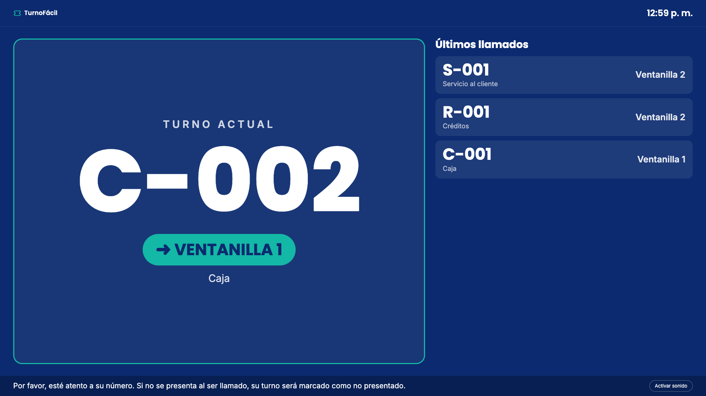

# TurnoFácil · Sistema de Turnos

Sistema web para organizar la atención por orden de llegada en un centro de atención (banco, clínica u oficina pública). El cliente saca su turno en un kiosco, una pantalla pública lo anuncia y el recepcionista lo atiende desde su ventanilla.

**Grupo 2 · Ingeniería de Software II · UNICARIBE · 2026**



## Inicio rápido (Docker)

Requisito: [Docker Desktop](https://www.docker.com/products/docker-desktop/).

```bash
git clone https://github.com/JosueNavarrop/sistema-de-turnos.git
cd sistema-de-turnos
docker compose up -d --build
```

Abrir **http://localhost:8000**. La primera vez tarda 1–2 minutos mientras se descargan las imágenes y se inicia MySQL.

| Usuario | Contraseña | Rol |
|---|---|---|
| `admin` | `admin123` | Administrador |
| `aperez` | `recep123` | Recepcionista · Ventanilla 1 (Caja) |
| `lgomez` | `recep123` | Recepcionista · Ventanilla 2 (Servicio al cliente, Créditos) |

> Cambie estas contraseñas desde **Administración → Usuarios** antes de usar el sistema con clientes reales.

## Partes del sistema

| Ruta | Pantalla | Quién la usa |
|---|---|---|
| `/kiosco` | Generar turno | Cliente, en una tablet a la entrada |
| `/pantalla` | Turno actual y últimos llamados | Cliente, en la TV de la sala |
| `/login` | Iniciar sesión | Personal |
| `/recepcion` | Llamar, atender y cerrar turnos | Recepcionista |
| `/admin` | Servicios, ventanillas y usuarios | Administrador |
| `/turnos` | Historial con filtros y totales | Administrador y recepcionista |
| `/docs` | Documentación de la API (Swagger) | Desarrolladores |

## Tecnología

**Vue 3 + Vite** (frontend) · **Python 3.12 + FastAPI** (API REST) · **SQLAlchemy 2** · **MySQL 8.4** · **JWT + bcrypt** · **Docker Compose**.

```
sistema-de-turnos/
├── backend/        API FastAPI, reglas de negocio y pruebas (pytest)
├── frontend/       Aplicación Vue 3
├── database/       schema.sql (MySQL)
├── docs/           Manuales, casos de prueba y documentos de diseño
├── Dockerfile      Imagen única: compila el frontend y lo sirve desde FastAPI
└── docker-compose.yml
```

## Pruebas

```bash
cd backend
python -m venv .venv && source .venv/bin/activate
pip install -r requirements.txt
pytest -v
```

15 casos de prueba automatizados (CP-01 a CP-15), descritos en [docs/casos-de-prueba.md](docs/casos-de-prueba.md).

## Documentación

- [Manual de usuario](docs/manual-usuario.md)
- [Manual técnico](docs/manual-tecnico.md) — instalación sin Docker, configuración, arquitectura, API y base de datos
- [Casos de prueba](docs/casos-de-prueba.md)
- [Documentos de diseño (entrega 1)](docs/diseno/): requerimientos, línea gráfica, casos de uso, arquitectura y base de datos
