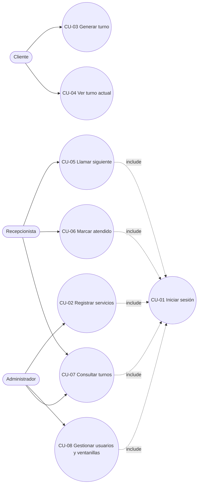
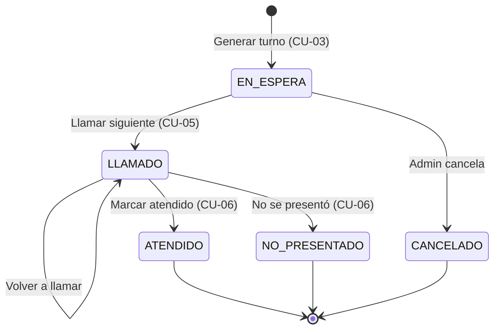

# 03 · Casos de uso — "TurnoFácil"

**Grupo 2 · Ingeniería de Software II · UNICARIBE · Entrega 1 (08/10/2026)**

## 1. Actores

| Actor | Tipo | Descripción |
|---|---|---|
| Cliente | Primario | Saca turno y consulta la pantalla pública. |
| Recepcionista | Primario | Llama y cierra turnos en su ventanilla. |
| Administrador | Primario | Configura el sistema y consulta reportes. |

## 2. Diagrama de casos de uso

```
                    ┌──────────────── Sistema de Turnos ────────────────┐
                    │                                                    │
   ┌─────────┐      │   (CU-03 Generar turno)                            │
   │ Cliente │──────┼──►(CU-04 Ver turno actual)                         │
   └─────────┘      │                                                    │
                    │   (CU-01 Iniciar sesión) ◄─────────┬───────────────┤
   ┌─────────────┐  │   (CU-05 Llamar siguiente turno)   │               │
   │Recepcionista│──┼──►(CU-06 Marcar atendido)          │ «include»     │
   └─────────────┘  │   (CU-07 Consultar turnos) ◄───┐   │               │
                    │                                │   │               │
   ┌─────────────┐  │   (CU-02 Registrar servicios)  │   │               │
   │Administrador│──┼──►(CU-08 Gestionar usuarios    │   │               │
   └─────────────┘  │         y ventanillas)  ───────┘───┘               │
                    └────────────────────────────────────────────────────┘
   CU-02, CU-05, CU-06, CU-07 y CU-08 «incluyen» CU-01 Iniciar sesión
```

Versión Mermaid (pegar en mermaid.live para exportar imagen):



## 3. Especificación de casos de uso

### CU-01 · Iniciar sesión
| Campo | Detalle |
|---|---|
| Actor | Recepcionista, Administrador |
| Requerimiento | RF-01 |
| Precondición | El usuario existe y está activo. |
| Flujo principal | 1. El usuario abre el sistema.<br>2. Ingresa usuario y contraseña.<br>3. El sistema valida las credenciales.<br>4. Muestra el menú según el rol. |
| Flujos alternos | 3a. Credenciales inválidas → "Usuario o contraseña inválidos".<br>3b. Usuario inactivo → "Usuario deshabilitado, contacte al administrador". |
| Postcondición | Sesión activa con su rol. |

### CU-02 · Registrar servicio
| Campo | Detalle |
|---|---|
| Actor | Administrador |
| Requerimiento | RF-02 |
| Precondición | Sesión iniciada como Admin. |
| Flujo principal | 1. Entra a *Servicios*.<br>2. Pulsa *Nuevo servicio*.<br>3. Ingresa nombre, prefijo y descripción.<br>4. Pulsa *Guardar*.<br>5. El sistema valida y lo muestra en la lista. |
| Flujos alternos | 5a. Prefijo duplicado → solicita otro.<br>5b. Campos obligatorios vacíos → los marca en rojo.<br>1a. Editar/desactivar: selecciona un servicio, cambia datos o estado y guarda (RN-04). |
| Postcondición | Servicio disponible (o no) en el kiosco. |

### CU-03 · Generar turno
| Campo | Detalle |
|---|---|
| Actor | Cliente |
| Requerimiento | RF-03 |
| Precondición | Existe al menos un servicio activo. |
| Flujo principal | 1. El cliente toca un servicio en el kiosco.<br>2. El sistema calcula el siguiente número del día para ese servicio (RN-01).<br>3. Crea el turno en estado `EN_ESPERA`.<br>4. Muestra el código (ej. C-015) y las personas delante. |
| Flujos alternos | 2a. Error de conexión → "Intente de nuevo"; no se crea el turno. |
| Postcondición | Turno `EN_ESPERA` en la cola del servicio. |

### CU-04 · Ver turno actual
| Campo | Detalle |
|---|---|
| Actor | Cliente |
| Requerimiento | RF-04 |
| Precondición | Pantalla pública encendida. |
| Flujo principal | 1. La pantalla consulta los turnos llamados cada 3 s.<br>2. Muestra en grande el último turno y su ventanilla.<br>3. Lista los 5 anteriores.<br>4. Si hay un llamado nuevo, lo resalta y emite un tono. |
| Flujos alternos | 1a. Sin turnos llamados hoy → "Bienvenido, en breve le atenderemos". |
| Postcondición | Ninguna (solo lectura). |

### CU-05 · Llamar siguiente turno
| Campo | Detalle |
|---|---|
| Actor | Recepcionista |
| Requerimiento | RF-05 |
| Precondición | Sesión iniciada, ventanilla asignada, sin turno abierto (RN-03). |
| Flujo principal | 1. Pulsa *Llamar siguiente*.<br>2. El sistema busca el turno `EN_ESPERA` más antiguo de los servicios de su ventanilla (RN-02).<br>3. Lo cambia a `LLAMADO` con hora, ventanilla y usuario.<br>4. El turno aparece en la pantalla pública. |
| Flujos alternos | 2a. No hay turnos en espera → "No hay clientes en espera".<br>1a. Tiene un turno abierto → el botón está deshabilitado. |
| Postcondición | Turno en estado `LLAMADO`. |

### CU-06 · Marcar atendido
| Campo | Detalle |
|---|---|
| Actor | Recepcionista |
| Requerimiento | RF-06 |
| Precondición | Tiene un turno `LLAMADO`. |
| Flujo principal | 1. Termina la atención.<br>2. Pulsa *Atendido*.<br>3. El sistema guarda la hora de fin y el estado `ATENDIDO`. |
| Flujos alternos | 2a. El cliente no llegó → *No se presentó* → `NO_PRESENTADO`.<br>2b. *Volver a llamar* → el turno se vuelve a anunciar en pantalla. |
| Postcondición | Ventanilla libre para llamar otro turno. |

### CU-07 · Consultar turnos
| Campo | Detalle |
|---|---|
| Actor | Administrador, Recepcionista |
| Requerimiento | RF-07 |
| Precondición | Sesión iniciada. |
| Flujo principal | 1. Entra a *Consultar turnos*.<br>2. Filtra por fecha, servicio y estado.<br>3. El sistema muestra la tabla y los totales (atendidos, no presentados, espera promedio). |
| Flujos alternos | 3a. Sin resultados → "Sin turnos para ese filtro". |
| Postcondición | Ninguna (solo lectura). |

### CU-08 · Gestionar usuarios y ventanillas
| Campo | Detalle |
|---|---|
| Actor | Administrador |
| Requerimiento | RF-08 |
| Precondición | Sesión iniciada como Admin. |
| Flujo principal | 1. Crea una ventanilla y marca los servicios que atiende.<br>2. Crea un usuario recepcionista (nombre, usuario, contraseña).<br>3. Lo asigna a la ventanilla.<br>4. Guarda. |
| Flujos alternos | 2a. Usuario duplicado → solicita otro.<br>3a. Desactivar usuario → ya no puede iniciar sesión. |
| Postcondición | El recepcionista puede atender en esa ventanilla. |

## 4. Diagrama de estados del turno


