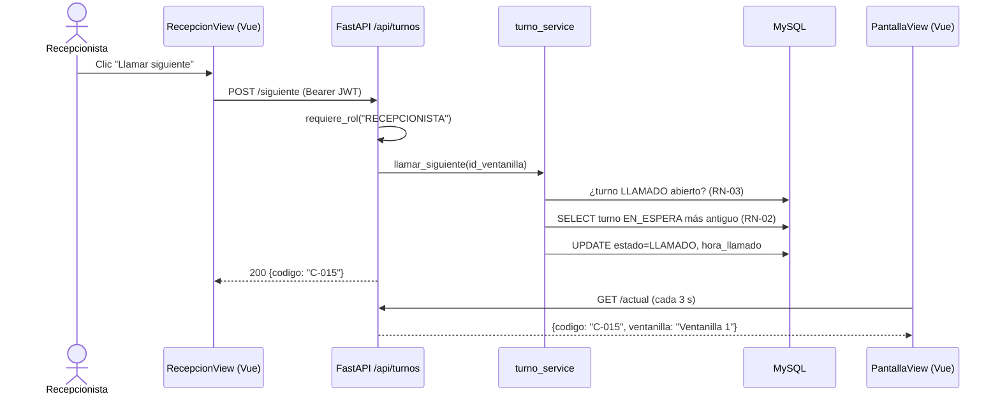

# 04 · Arquitectura — "TurnoFácil"

**Grupo 2 · Ingeniería de Software II · UNICARIBE · Entrega 1 (08/10/2026)**

## 1. Estilo arquitectónico

Aplicación web **cliente-servidor en 3 capas**: un frontend **SPA en Vue 3** que consume una **API REST (JSON)** hecha en **FastAPI**, organizada por capas (routers → servicios → modelos), sobre **MySQL 8**.

```
┌─────────────────────── CAPA DE PRESENTACIÓN ───────────────────────┐
│  Vue 3 (SPA) + Vue Router + Pinia                                  │
│  Vistas: Kiosco (P1) · Pantalla pública (P2) · Login (P3)          │
│          Recepción (P4) · Administración (P5) · Turnos (P6)        │
└───────────────────────────────┬────────────────────────────────────┘
                                │ HTTP / JSON (API REST) + JWT
┌───────────────────────────────▼──── CAPA DE LÓGICA ────────────────┐
│  Python + FastAPI (Uvicorn)                                        │
│  Routers → Servicios (reglas de negocio RN-01..05) → Modelos       │
│  Schemas Pydantic (validación) · Dependencias: auth y rol          │
└───────────────────────────────┬────────────────────────────────────┘
                                │ SQLAlchemy 2 + PyMySQL
┌───────────────────────────────▼──── CAPA DE DATOS ─────────────────┐
│  MySQL 8: usuarios, servicios, ventanillas, ventanilla_servicio,   │
│           turnos                                                   │
└────────────────────────────────────────────────────────────────────┘
```

## 2. Tecnologías

| Capa | Tecnología | Justificación |
|---|---|---|
| Frontend | Vue 3 + Vite | Framework fácil de aprender; componentes reutilizables (botón de servicio, etiqueta de estado, tarjeta de turno). |
| Navegación | Vue Router | Una ruta por pantalla y guardias por rol. |
| Estado | Pinia | Guarda la sesión (token, rol, ventanilla) compartida entre vistas. |
| HTTP | Axios | Cliente HTTP con interceptor que agrega el JWT. |
| Backend | Python 3.12 + FastAPI + Uvicorn | API rápida de construir; documentación automática (Swagger en `/docs`). |
| Validación | Pydantic v2 | Valida entradas y salidas de la API sin código extra. |
| Acceso a datos | SQLAlchemy 2 + PyMySQL | ORM que mapea las 5 tablas; consultas seguras contra inyección SQL. |
| Seguridad | JWT (`PyJWT`) + `bcrypt` | Sesiones sin estado y contraseñas cifradas (RNF-03). |
| Base de datos | MySQL 8 | Modelo relacional, gratuito, conocido por el grupo. |
| Control de versiones | Git + GitHub | Trabajo en equipo y entregas incrementales. |

## 3. Despliegue

```
 ┌──────────────┐   ┌──────────────┐   ┌──────────────────┐
 │ Tablet kiosco│   │ TV pantalla  │   │ PC recepción/    │
 │  (navegador) │   │  (navegador) │   │ admin (navegador)│
 └──────┬───────┘   └──────┬───────┘   └────────┬─────────┘
        └──────────── Red local (Wi-Fi/LAN) ────┘
                           │
                 ┌─────────▼──────────────────┐
                 │ Servidor                   │
                 │ Frontend Vue (build) :5173 │
                 │ FastAPI / Uvicorn    :8000 │
                 │ MySQL                :3306 │
                 └────────────────────────────┘
```

En desarrollo, Vite sirve el frontend en `:5173` y FastAPI en `:8000` (CORS habilitado para ese origen). En la versión liberable, el `build` de Vue se sirve como archivos estáticos.

## 4. Estructura del proyecto

```
turnofacil/
├── backend/
│   ├── app/
│   │   ├── main.py            # crea la app, CORS, incluye routers
│   │   ├── config.py          # variables de entorno (DB, JWT_SECRET)
│   │   ├── database.py        # engine y sesión de SQLAlchemy
│   │   ├── models/            # ORM: usuario, servicio, ventanilla, turno
│   │   ├── schemas/           # Pydantic: entrada/salida de la API
│   │   ├── services/          # reglas de negocio (RN-01..05)
│   │   ├── routers/           # auth, servicios, ventanillas, usuarios, turnos
│   │   └── core/security.py   # JWT, hash, dependencias get_usuario / requiere_rol
│   ├── requirements.txt
│   └── .env.example
├── frontend/
│   ├── src/
│   │   ├── views/             # KioscoView, PantallaView, LoginView,
│   │   │                      # RecepcionView, AdminView, TurnosView
│   │   ├── components/        # BotonServicio, EtiquetaEstado, TarjetaTurno
│   │   ├── router/index.js    # rutas + guardias por rol
│   │   ├── stores/sesion.js   # Pinia: token, rol, ventanilla
│   │   ├── api/               # cliente Axios
│   │   └── assets/estilos.css # tokens de la línea gráfica
│   └── package.json
└── database/
    └── schema.sql
```

## 5. Rutas del frontend

| Ruta | Vista | Pantalla | Acceso |
|---|---|---|---|
| `/kiosco` | KioscoView | P1 | Público |
| `/pantalla` | PantallaView | P2 | Público |
| `/login` | LoginView | P3 | Público |
| `/recepcion` | RecepcionView | P4 | Recepcionista |
| `/admin` | AdminView | P5 | Administrador |
| `/turnos` | TurnosView | P6 | Admin, Recepcionista |

## 6. API REST

| Método | Ruta | Descripción | Rol | RF |
|---|---|---|---|---|
| POST | `/api/auth/login` | Iniciar sesión, devuelve JWT | Público | RF-01 |
| GET | `/api/servicios?activos=true` | Listar servicios | Público | RF-03 |
| POST | `/api/servicios` | Crear servicio | Admin | RF-02 |
| PUT | `/api/servicios/{id}` | Editar / activar / desactivar | Admin | RF-02 |
| POST | `/api/turnos` | Generar turno `{id_servicio}` | Público | RF-03 |
| GET | `/api/turnos/actual` | Turno actual + últimos 5 | Público | RF-04 |
| POST | `/api/turnos/siguiente` | Llamar siguiente de mi ventanilla | Recepcionista | RF-05 |
| PUT | `/api/turnos/{id}/estado` | `{estado: ATENDIDO \| NO_PRESENTADO}` | Recepcionista | RF-06 |
| GET | `/api/turnos?fecha=&servicio=&estado=` | Consultar con filtros | Admin, Recep. | RF-07 |
| GET/POST/PUT | `/api/ventanillas` | Gestionar ventanillas | Admin | RF-08 |
| GET/POST/PUT | `/api/usuarios` | Gestionar usuarios | Admin | RF-08 |

La documentación interactiva de todos los endpoints queda disponible en `http://servidor:8000/docs` (Swagger, generada por FastAPI).

## 7. Flujo de ejemplo: llamar siguiente turno



## 8. Decisiones de diseño

| Decisión | Alternativa descartada | Motivo |
|---|---|---|
| Vue 3 (SPA) | HTML + JS vanilla, React | Componentes reutilizables con curva de aprendizaje menor que React. |
| FastAPI | Node + Express, Django | Validación con Pydantic y Swagger automático (apoya pruebas y manual técnico); más liviano que Django. |
| Polling cada 3 s en la pantalla pública | WebSockets | Más simple para el MVP y cumple RNF-02. FastAPI soporta WebSockets si se quiere migrar luego. |
| JWT | Sesiones en servidor | Sin estado; protección de rutas por rol con una dependencia de FastAPI. |
| Número de turno calculado por servicio y día dentro de una transacción (`SELECT … FOR UPDATE`) | Contador global | Cumple RN-01 y evita números repetidos con dos kioscos a la vez. |
| SQLAlchemy ORM | SQL a mano | Menos código repetido y consultas parametrizadas (seguridad). |
