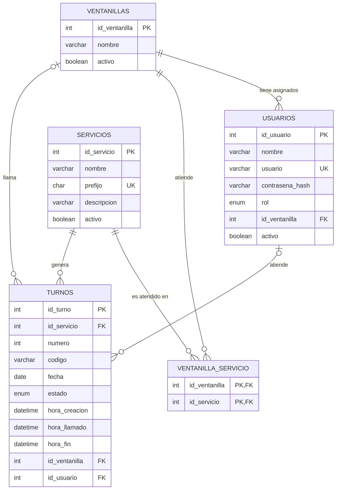

# 05 · Base de datos — "TurnoFácil"

**Grupo 2 · Ingeniería de Software II · UNICARIBE · Entrega 1 (08/10/2026)**

Motor: **MySQL 8**. Base de datos: `turnofacil`. 5 tablas.

## 1. Modelo entidad-relación



## 2. Relaciones

| Relación | Cardinalidad | Descripción |
|---|---|---|
| ventanillas → usuarios | 1 : N | Una ventanilla puede tener varios recepcionistas (turnos de trabajo); un usuario tiene máximo una ventanilla. |
| ventanillas ↔ servicios | N : M (vía `ventanilla_servicio`) | Una ventanilla atiende varios servicios y un servicio se atiende en varias ventanillas. |
| servicios → turnos | 1 : N | Cada turno pertenece a un servicio. |
| ventanillas → turnos | 0..1 : N | El turno recibe ventanilla cuando es llamado. |
| usuarios → turnos | 0..1 : N | El turno registra qué recepcionista lo atendió. |

## 3. Diccionario de datos

### usuarios
| Campo | Tipo | Nulo | Descripción |
|---|---|---|---|
| id_usuario | INT PK AUTO_INCREMENT | No | Identificador |
| nombre | VARCHAR(100) | No | Nombre completo |
| usuario | VARCHAR(50) UNIQUE | No | Nombre de acceso |
| contrasena_hash | VARCHAR(255) | No | Contraseña cifrada con bcrypt |
| rol | ENUM('ADMIN','RECEPCIONISTA') | No | Rol |
| id_ventanilla | INT FK → ventanillas | Sí | Ventanilla asignada (solo recepcionistas) |
| activo | BOOLEAN (def. TRUE) | No | Puede iniciar sesión |

### servicios
| Campo | Tipo | Nulo | Descripción |
|---|---|---|---|
| id_servicio | INT PK AUTO_INCREMENT | No | Identificador |
| nombre | VARCHAR(80) | No | Ej. "Caja" |
| prefijo | CHAR(1) UNIQUE | No | Letra del turno (C, S, R) |
| descripcion | VARCHAR(200) | Sí | Texto de ayuda |
| activo | BOOLEAN (def. TRUE) | No | Visible en el kiosco (RN-04) |

### ventanillas
| Campo | Tipo | Nulo | Descripción |
|---|---|---|---|
| id_ventanilla | INT PK AUTO_INCREMENT | No | Identificador |
| nombre | VARCHAR(30) | No | Ej. "Ventanilla 1" |
| activo | BOOLEAN (def. TRUE) | No | En operación |

### ventanilla_servicio
| Campo | Tipo | Nulo | Descripción |
|---|---|---|---|
| id_ventanilla | INT PK, FK → ventanillas | No | Ventanilla |
| id_servicio | INT PK, FK → servicios | No | Servicio que atiende |

### turnos
| Campo | Tipo | Nulo | Descripción |
|---|---|---|---|
| id_turno | INT PK AUTO_INCREMENT | No | Identificador |
| id_servicio | INT FK → servicios | No | Servicio solicitado |
| numero | INT | No | Consecutivo del día por servicio (RN-01) |
| codigo | VARCHAR(10) | No | Ej. "C-015" |
| fecha | DATE | No | Día del turno |
| estado | ENUM('EN_ESPERA','LLAMADO','ATENDIDO','NO_PRESENTADO','CANCELADO') | No | Estado (RN-05) |
| hora_creacion | DATETIME (def. NOW) | No | Llegada del cliente |
| hora_llamado | DATETIME | Sí | Cuándo se llamó |
| hora_fin | DATETIME | Sí | Cuándo se cerró |
| id_ventanilla | INT FK → ventanillas | Sí | Ventanilla que lo llamó |
| id_usuario | INT FK → usuarios | Sí | Recepcionista que lo atendió |

**Restricciones clave:** `UNIQUE (id_servicio, fecha, numero)` garantiza RN-01; el índice `(estado, id_servicio, hora_creacion)` acelera la búsqueda del siguiente turno (RN-02).

## 4. Script SQL

```sql
CREATE DATABASE IF NOT EXISTS turnofacil
  CHARACTER SET utf8mb4 COLLATE utf8mb4_unicode_ci;
USE turnofacil;

CREATE TABLE ventanillas (
  id_ventanilla INT AUTO_INCREMENT PRIMARY KEY,
  nombre        VARCHAR(30) NOT NULL,
  activo        BOOLEAN NOT NULL DEFAULT TRUE
);

CREATE TABLE servicios (
  id_servicio INT AUTO_INCREMENT PRIMARY KEY,
  nombre      VARCHAR(80) NOT NULL,
  prefijo     CHAR(1) NOT NULL UNIQUE,
  descripcion VARCHAR(200),
  activo      BOOLEAN NOT NULL DEFAULT TRUE
);

CREATE TABLE usuarios (
  id_usuario      INT AUTO_INCREMENT PRIMARY KEY,
  nombre          VARCHAR(100) NOT NULL,
  usuario         VARCHAR(50)  NOT NULL UNIQUE,
  contrasena_hash VARCHAR(255) NOT NULL,
  rol             ENUM('ADMIN','RECEPCIONISTA') NOT NULL,
  id_ventanilla   INT NULL,
  activo          BOOLEAN NOT NULL DEFAULT TRUE,
  FOREIGN KEY (id_ventanilla) REFERENCES ventanillas(id_ventanilla)
);

CREATE TABLE ventanilla_servicio (
  id_ventanilla INT NOT NULL,
  id_servicio   INT NOT NULL,
  PRIMARY KEY (id_ventanilla, id_servicio),
  FOREIGN KEY (id_ventanilla) REFERENCES ventanillas(id_ventanilla),
  FOREIGN KEY (id_servicio)   REFERENCES servicios(id_servicio)
);

CREATE TABLE turnos (
  id_turno      INT AUTO_INCREMENT PRIMARY KEY,
  id_servicio   INT NOT NULL,
  numero        INT NOT NULL,
  codigo        VARCHAR(10) NOT NULL,
  fecha         DATE NOT NULL,
  estado        ENUM('EN_ESPERA','LLAMADO','ATENDIDO','NO_PRESENTADO','CANCELADO')
                NOT NULL DEFAULT 'EN_ESPERA',
  hora_creacion DATETIME NOT NULL DEFAULT CURRENT_TIMESTAMP,
  hora_llamado  DATETIME NULL,
  hora_fin      DATETIME NULL,
  id_ventanilla INT NULL,
  id_usuario    INT NULL,
  UNIQUE KEY uq_turno_dia (id_servicio, fecha, numero),
  INDEX idx_cola (estado, id_servicio, hora_creacion),
  FOREIGN KEY (id_servicio)   REFERENCES servicios(id_servicio),
  FOREIGN KEY (id_ventanilla) REFERENCES ventanillas(id_ventanilla),
  FOREIGN KEY (id_usuario)    REFERENCES usuarios(id_usuario)
);
```

## 5. Datos de ejemplo

```sql
INSERT INTO servicios (nombre, prefijo, descripcion) VALUES
 ('Caja', 'C', 'Pagos y depósitos'),
 ('Servicio al cliente', 'S', 'Consultas y reclamaciones'),
 ('Créditos', 'R', 'Solicitudes de préstamo');

INSERT INTO ventanillas (nombre) VALUES ('Ventanilla 1'), ('Ventanilla 2');

INSERT INTO ventanilla_servicio VALUES (1, 1), (2, 2), (2, 3);

-- Contraseñas: generar el hash con bcrypt desde el backend antes de insertar
INSERT INTO usuarios (nombre, usuario, contrasena_hash, rol, id_ventanilla) VALUES
 ('Administrador', 'admin', '<hash_bcrypt>', 'ADMIN', NULL),
 ('Ana Pérez', 'aperez', '<hash_bcrypt>', 'RECEPCIONISTA', 1);
```

## 6. Consultas principales

```sql
-- RF-03 Generar turno (dentro de una transacción)
SELECT COALESCE(MAX(numero), 0) + 1 AS siguiente
FROM turnos WHERE id_servicio = ? AND fecha = CURDATE() FOR UPDATE;

-- RF-05 Siguiente turno para una ventanilla (RN-02)
SELECT t.id_turno, t.codigo
FROM turnos t
JOIN ventanilla_servicio vs ON vs.id_servicio = t.id_servicio
WHERE vs.id_ventanilla = ? AND t.estado = 'EN_ESPERA' AND t.fecha = CURDATE()
ORDER BY t.hora_creacion
LIMIT 1;

-- RF-04 Pantalla pública: últimos 6 llamados
SELECT t.codigo, v.nombre AS ventanilla, t.hora_llamado
FROM turnos t JOIN ventanillas v ON v.id_ventanilla = t.id_ventanilla
WHERE t.fecha = CURDATE() AND t.hora_llamado IS NOT NULL
ORDER BY t.hora_llamado DESC
LIMIT 6;

-- RF-07 Totales y espera promedio del día
SELECT estado, COUNT(*) AS total,
       ROUND(AVG(TIMESTAMPDIFF(MINUTE, hora_creacion, hora_llamado))) AS espera_min
FROM turnos WHERE fecha = ?
GROUP BY estado;
```
