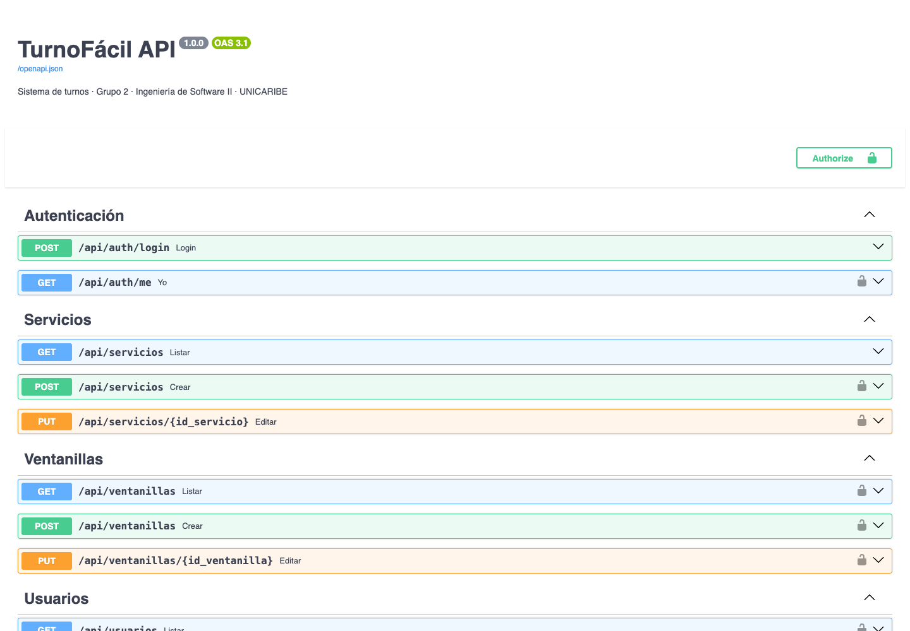

# Manual técnico · TurnoFácil

**Versión 1.0 · Grupo 2 · Ingeniería de Software II · UNICARIBE · 22/10/2026**

Este manual explica cómo instalar, configurar, mantener y extender TurnoFácil. Para el uso diario del sistema, vea el [manual de usuario](manual-usuario.md).

## 1. Arquitectura

Aplicación web cliente-servidor en 3 capas, empaquetada en dos contenedores Docker.

```
 Tablet (kiosco)   TV (pantalla)   PC (recepción / admin)
        └──────────────┬──────────────┘   navegador
                       │ HTTP · JSON · JWT
        ┌──────────────▼───────────────────────────┐
        │ Contenedor app  (puerto 8000)            │
        │  FastAPI · routers → reglas → modelos    │
        │  + frontend Vue compilado (frontend/dist)│
        └──────────────┬───────────────────────────┘
                       │ SQLAlchemy 2 + PyMySQL
        ┌──────────────▼──────────────┐
        │ Contenedor db · MySQL 8.4   │
        │ volumen datos-mysql         │
        └─────────────────────────────┘
```

| Capa | Tecnología | Ubicación |
|---|---|---|
| Presentación | Vue 3, Vue Router, Pinia, Axios, Vite | `frontend/src` |
| Lógica | Python 3.12, FastAPI, Pydantic v2 | `backend/app` |
| Datos | SQLAlchemy 2, MySQL 8.4 (SQLite para desarrollo y pruebas) | `backend/app/models.py`, `database/schema.sql` |
| Seguridad | JWT (PyJWT, HS256) y contraseñas con bcrypt | `backend/app/security.py` |
| Despliegue | Docker, Docker Compose | `Dockerfile`, `docker-compose.yml` |

La pantalla pública y el panel de recepción consultan la API cada 3 segundos (RNF-02). Es más simple que WebSockets y suficiente para una sucursal.

## 2. Requisitos

| Para | Necesita |
|---|---|
| Instalar con Docker (recomendado) | Docker Desktop 4.x o Docker Engine con Compose v2 |
| Desarrollar sin Docker | Python 3.12+, Node.js 20+, y MySQL 8 (opcional: sin MySQL usa SQLite) |
| Usar el sistema | Chrome, Edge o Firefox actuales en la red local |

## 3. Instalación con Docker

```bash
git clone https://github.com/JosueNavarrop/sistema-de-turnos.git
cd sistema-de-turnos
cp .env.example .env          # opcional: cambiar claves y puerto
docker compose up -d --build
```

Qué pasa al iniciar:

1. MySQL arranca. La primera vez ejecuta `database/schema.sql`, que crea las tablas y los servicios y ventanillas de ejemplo.
2. Cuando MySQL responde (healthcheck), arranca la app.
3. La app crea las tablas que falten y, si no hay usuarios, crea los 3 usuarios iniciales con contraseñas cifradas.

Abrir **http://localhost:8000**. Desde otros equipos de la red: `http://IP-DEL-SERVIDOR:8000/kiosco`, `/pantalla`, etc.

### Comandos útiles

| Acción | Comando |
|---|---|
| Ver estado | `docker compose ps` |
| Ver registros de la app | `docker compose logs -f app` |
| Detener (conserva los datos) | `docker compose down` |
| Actualizar tras un `git pull` | `docker compose up -d --build` |
| Respaldar la base | `docker compose exec db mysqldump -uturnofacil -pturnofacil turnofacil > respaldo.sql` |
| Restaurar un respaldo | `docker compose exec -T db mysql -uturnofacil -pturnofacil turnofacil < respaldo.sql` |
| Abrir la consola de MySQL | `docker compose exec db mysql -uturnofacil -pturnofacil turnofacil` |
| Borrar todo y empezar de cero | `docker compose down -v` (elimina el volumen con los datos) |

MySQL también queda expuesto en el puerto **3307** del equipo para conectarse con MySQL Workbench o DBeaver.

## 4. Configuración

Variables del archivo `.env` (raíz del proyecto, usado por Docker Compose):

| Variable | Por defecto | Descripción |
|---|---|---|
| `MYSQL_ROOT_PASSWORD` | `turnofacil-root` | Contraseña de root de MySQL |
| `MYSQL_PASSWORD` | `turnofacil` | Contraseña del usuario `turnofacil` de la base |
| `JWT_SECRET` | clave de desarrollo | Clave para firmar los tokens. **Cambiarla en producción** (mínimo 32 caracteres) |
| `MINUTOS_POR_PERSONA` | `3` | Minutos por persona para la espera estimada del kiosco |
| `TZ` | `America/Santo_Domingo` | Zona horaria de los turnos |
| `PUERTO` | `8000` | Puerto donde se publica la app |

Sin Docker, el backend lee `backend/.env` (ver `backend/.env.example`), donde además se define `DATABASE_URL` y `CORS_ORIGINS`.

## 5. Desarrollo sin Docker

```bash
# Backend (terminal 1)
cd backend
python -m venv .venv && source .venv/bin/activate      # Windows: .venv\Scripts\activate
pip install -r requirements.txt
cp .env.example .env                                     # SQLite por defecto
uvicorn app.main:app --reload --port 8000

# Frontend (terminal 2)
cd frontend
npm install
npm run dev                                              # http://localhost:5173
```

Vite redirige `/api` al backend en el puerto 8000. Para probar la versión compilada sin Docker: `npm run build` en `frontend` y abrir http://localhost:8000; FastAPI sirve `frontend/dist`.

Datos iniciales a mano: `python -m app.seed` (o `python -m app.seed --reiniciar` para borrar todo y recargar).

## 6. Estructura del código

```
backend/app/
├── main.py         Crea la app, CORS, rutas y sirve el frontend compilado
├── config.py       Variables de entorno
├── database.py     Conexión y sesión de SQLAlchemy
├── models.py       Tablas: Usuario, Servicio, Ventanilla, ventanilla_servicio, Turno
├── schemas.py      Validación de entradas (Pydantic) y formato de respuestas
├── security.py     Hash de contraseñas, JWT, get_usuario y requiere_rol
├── turnos.py       Reglas de negocio RN-01 a RN-05
├── seed.py         Datos iniciales
└── routers/        auth, servicios, ventanillas, usuarios, turnos
backend/tests/      Casos de prueba CP-01 a CP-15 (pytest)

frontend/src/
├── views/          InicioView, KioscoView, PantallaView, LoginView,
│                   RecepcionView, AdminView, TurnosView
├── components/     StaffHeader, Modal, EstadoBadge, Logo, Toast, admin/*Tab
├── router.js       Rutas y guardia por rol
├── stores/sesion.js  Sesión (token, usuario, rol) con Pinia
├── api.js          Cliente Axios con el token y manejo de errores
└── styles.css      Variables de la línea gráfica
```

### Dónde vive cada regla de negocio

| Regla | Implementación |
|---|---|
| RN-01 Numeración diaria por servicio | `turnos.generar_turno` + restricción única `(id_servicio, fecha, numero)`; reintenta si dos kioscos generan a la vez |
| RN-02 Orden de llegada | `turnos.llamar_siguiente`: el `EN_ESPERA` más antiguo de los servicios de la ventanilla, con bloqueo `FOR UPDATE` |
| RN-03 Un turno abierto por ventanilla | `turnos.llamar_siguiente` responde 409 si la ventanilla tiene un `LLAMADO` |
| RN-04 Servicios inactivos | El kiosco pide `?activos=true`; `generar_turno` rechaza servicios inactivos |
| RN-05 Estados | `turnos.cerrar_turno`: solo el recepcionista de esa ventanilla cierra; solo el admin cancela turnos en espera |

## 7. API REST

Documentación interactiva generada por FastAPI: **http://localhost:8000/docs** (Swagger) y `/redoc`. Las rutas protegidas requieren el encabezado `Authorization: Bearer <token>` que devuelve el login.

| Método | Ruta | Descripción | Acceso |
|---|---|---|---|
| POST | `/api/auth/login` | Inicia sesión; devuelve token y usuario | Público |
| GET | `/api/auth/me` | Usuario de la sesión | Con sesión |
| GET | `/api/servicios?activos=true` | Servicios (con turnos de hoy) | Público |
| POST · PUT | `/api/servicios` · `/api/servicios/{id}` | Crear y editar servicios | Admin |
| GET | `/api/ventanillas` | Ventanillas con servicios, recepcionistas y turno actual | Con sesión |
| POST · PUT | `/api/ventanillas` · `/api/ventanillas/{id}` | Crear y editar ventanillas | Admin |
| GET · POST · PUT | `/api/usuarios` · `/api/usuarios/{id}` | Gestionar usuarios | Admin |
| POST | `/api/turnos` | Generar turno `{id_servicio}` | Público |
| GET | `/api/turnos/actual` | Turno actual y últimos 5 (pantalla pública) | Público |
| GET | `/api/turnos/mi-ventanilla` | Estado del panel del recepcionista | Recepcionista |
| POST | `/api/turnos/siguiente` | Llamar al siguiente | Recepcionista |
| POST | `/api/turnos/{id}/rellamar` | Volver a anunciar el turno | Recepcionista |
| PUT | `/api/turnos/{id}/estado` | `ATENDIDO`, `NO_PRESENTADO` (recepcionista) o `CANCELADO` (admin) | Con sesión |
| GET | `/api/turnos?fecha=&servicio=&estado=` | Consulta con totales | Con sesión |
| GET | `/api/salud` | Verificación de salud (healthcheck de Docker) | Público |

Errores: la API responde `{"detail": "mensaje"}` con 400 (datos inválidos), 401 (sin sesión), 403 (sin permiso), 404 (no existe) o 409 (regla de negocio), y 422 cuando Pydantic rechaza el formato.



## 8. Base de datos

Cinco tablas en MySQL 8 (`database/schema.sql`). El detalle de cada campo está en [diseno/05-base-de-datos.md](diseno/05-base-de-datos.md). Cambios respecto al diseño de la entrega 1:

| Tabla | Campo nuevo | Motivo |
|---|---|---|
| `usuarios` | `ultimo_acceso DATETIME` | Se muestra en Administración → Usuarios |
| `turnos` | `hora_anuncio DATETIME(6)` | Ordena la pantalla pública cuando se vuelve a llamar un turno; guarda microsegundos para distinguir anuncios del mismo segundo |

## 9. Pruebas

```bash
cd backend && source .venv/bin/activate
pytest -v
```

Cada prueba crea una base SQLite en memoria con los datos iniciales, así que no toca la base real. Detalle de los casos en [casos-de-prueba.md](casos-de-prueba.md).

## 10. Seguridad

- Contraseñas cifradas con bcrypt; nunca se guardan ni se devuelven en texto.
- Tokens JWT firmados con `JWT_SECRET`, válidos 10 horas.
- Cada ruta valida el rol en el servidor; el frontend solo oculta opciones.
- Antes de producción: cambiar `JWT_SECRET`, las contraseñas de MySQL y las de los usuarios iniciales.

## 11. Solución de problemas

| Síntoma | Causa probable | Solución |
|---|---|---|
| `port is already allocated` al iniciar | El puerto 8000 o 3307 está ocupado | Cambiar `PUERTO` en `.env` o detener el otro programa |
| La app se reinicia en bucle | MySQL aún no termina de iniciar la primera vez | Esperar 1 minuto; ver `docker compose logs db` |
| Acentos mal escritos (é) | Script SQL cargado sin `utf8mb4` | `schema.sql` ya incluye `SET NAMES utf8mb4`; recrear con `docker compose down -v` |
| La pantalla pública no suena | Los navegadores bloquean el audio sin interacción | Pulsar «Activar sonido» una vez en la TV |
| «No tiene una ventanilla activa asignada» | El recepcionista no tiene ventanilla o está inactiva | Asignarla en Administración → Usuarios |
| Horas desfasadas | Zona horaria distinta | Ajustar `TZ` en `.env` |
