# Manual de usuario · TurnoFácil

**Versión 1.0 · Grupo 2 · Ingeniería de Software II · UNICARIBE · 22/10/2026**

TurnoFácil organiza la atención por orden de llegada. El cliente saca un turno en el kiosco, espera a que la pantalla lo anuncie y pasa a la ventanilla indicada. Este manual explica cómo usarlo según su rol.

| Si usted es… | Lea |
|---|---|
| Cliente | [1. Sacar un turno](#1-sacar-un-turno-cliente) y [2. Pantalla pública](#2-pantalla-pública-cliente) |
| Recepcionista | [3. Iniciar sesión](#3-iniciar-sesión-personal), [4. Atender turnos](#4-atender-turnos-recepcionista) y [6. Consultar turnos](#6-consultar-turnos) |
| Administrador | [3. Iniciar sesión](#3-iniciar-sesión-personal), [5. Administración](#5-administración-administrador) y [6. Consultar turnos](#6-consultar-turnos) |

Al abrir la dirección del sistema (por ejemplo `http://servidor:8000`) aparece la página de inicio, con un acceso para cada dispositivo.

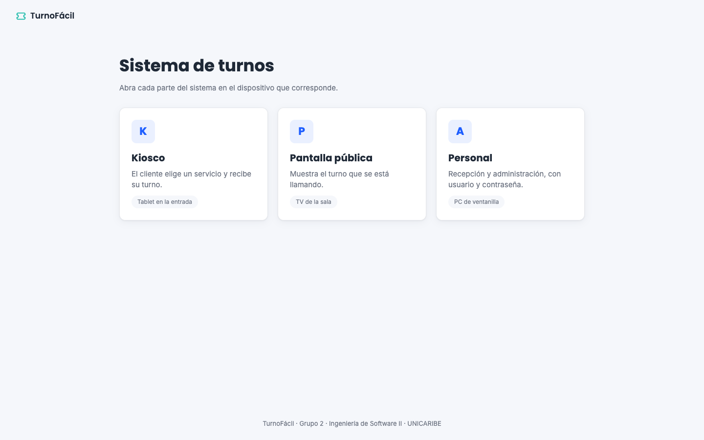

---

## 1. Sacar un turno (cliente)

El kiosco está en una tablet a la entrada.

1. Toque el servicio que necesita: **Caja**, **Servicio al cliente** o **Créditos**.

   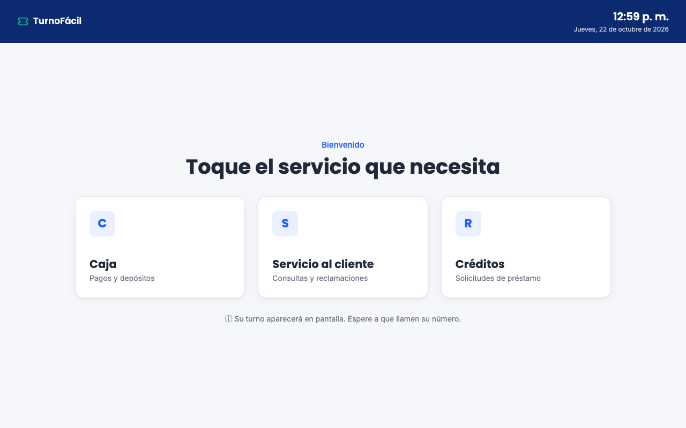

2. La pantalla muestra su número de turno, cuántas personas tiene delante y el tiempo de espera estimado.

   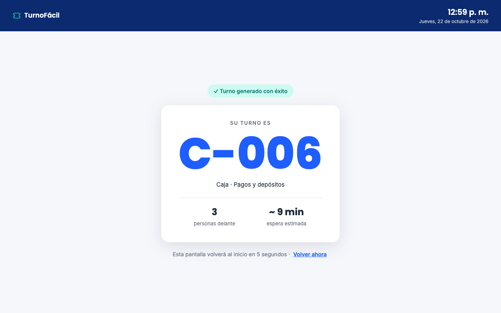

3. Recuerde su número (por ejemplo **C-015**). La pantalla vuelve sola al inicio a los 5 segundos.

> La letra del turno indica el servicio: **C** Caja, **S** Servicio al cliente, **R** Créditos.

## 2. Pantalla pública (cliente)

La TV de la sala muestra en grande el turno que se está llamando y la ventanilla a la que debe ir. A la derecha están los últimos turnos llamados.

- Cuando llaman un turno nuevo, el recuadro parpadea y suena un tono.
- Si no se presenta cuando llaman su número, el recepcionista puede marcarlo como **no presentado** y tendrá que sacar otro turno.

**Para el personal que instala la TV:** abra `http://servidor:8000/pantalla` en el navegador de la TV, póngalo en pantalla completa (F11) y pulse **Activar sonido** una vez; los navegadores no permiten sonido hasta que alguien toca la página.

## 3. Iniciar sesión (personal)

1. Abra `http://servidor:8000/login` o pulse **Personal** en la página de inicio.
2. Escriba su usuario y contraseña y pulse **Entrar**.
3. El sistema lo lleva a su panel: **Atención** si es recepcionista o **Administración** si es administrador.

Si los datos no son correctos aparece el mensaje «Usuario o contraseña inválidos». Si su usuario fue desactivado, verá «Usuario deshabilitado, contacte al administrador».

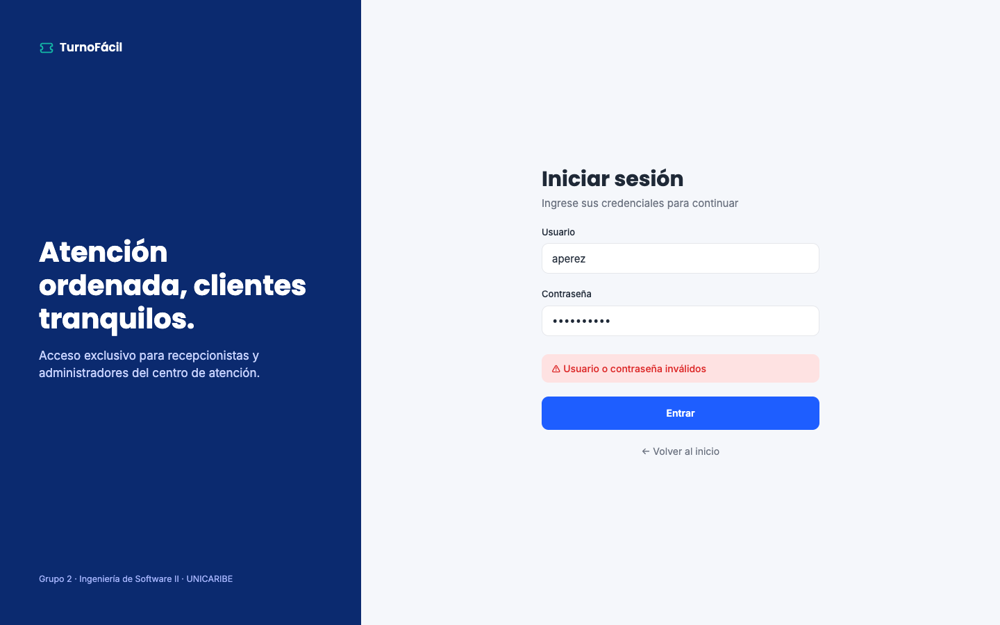

Para salir, pulse el ícono de salida ⇥ arriba a la derecha.

## 4. Atender turnos (recepcionista)

Su panel muestra la ventanilla asignada (arriba a la derecha), los clientes en espera de los servicios que atiende y su resumen del día.

### Llamar al siguiente cliente

Cuando no está atendiendo a nadie, el panel lo indica y el botón **Llamar siguiente** está activo.

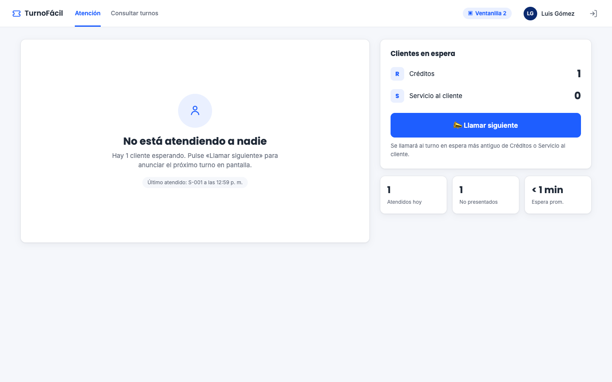

1. Pulse **Llamar siguiente**.
2. El sistema elige el turno más antiguo de sus servicios y lo anuncia en la pantalla pública.

### Atender y cerrar el turno

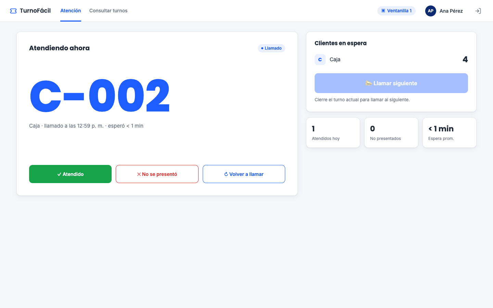

Mientras atiende, el turno aparece en grande con la hora en que se llamó y cuánto esperó el cliente. Al terminar, elija una opción:

| Botón | Cuándo usarlo | Qué pasa |
|---|---|---|
| **✓ Atendido** | Terminó de atender al cliente | El turno se cierra y suma a «Atendidos hoy» |
| **✕ No se presentó** | El cliente no llegó a la ventanilla | El turno se cierra como no presentado |
| **↻ Volver a llamar** | El cliente aún no llega y quiere anunciarlo otra vez | El turno vuelve a aparecer y sonar en la pantalla |

> **Llamar siguiente** queda desactivado mientras tenga un turno abierto: primero debe cerrarlo. Así cada ventanilla atiende a un cliente a la vez.

## 5. Administración (administrador)

La administración tiene tres pestañas: **Servicios**, **Ventanillas** y **Usuarios**. El botón azul de arriba a la derecha crea un elemento nuevo en la pestaña abierta; el lápiz ✎ de cada fila lo edita.

### Servicios

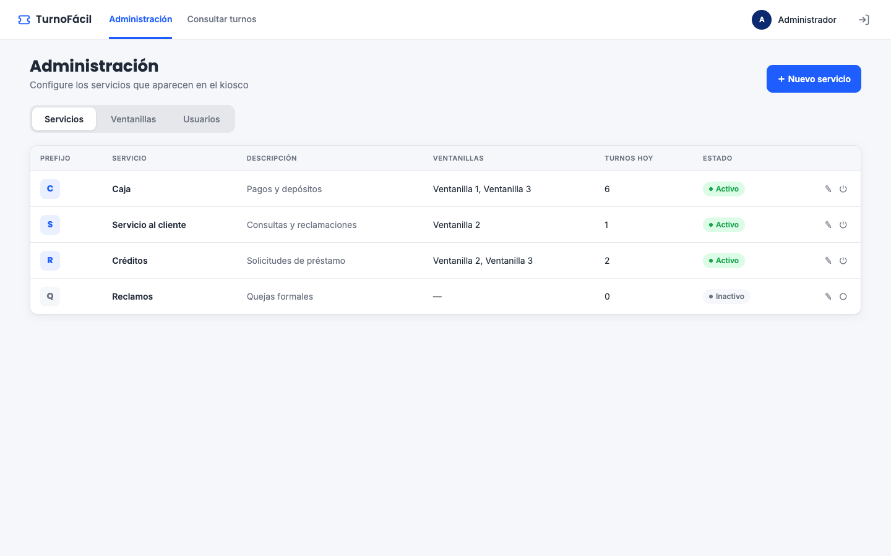

- **Crear un servicio:** pulse **Nuevo servicio**, escriba el nombre, una letra como prefijo y, si quiere, una descripción. Pulse **Guardar servicio**.
- **Desactivar o activar:** use el botón ⏻ de la fila. Un servicio inactivo deja de aparecer en el kiosco, pero conserva su historial.
- El prefijo no se puede repetir. Si elige uno que ya existe, el formulario le dice qué servicio lo usa.

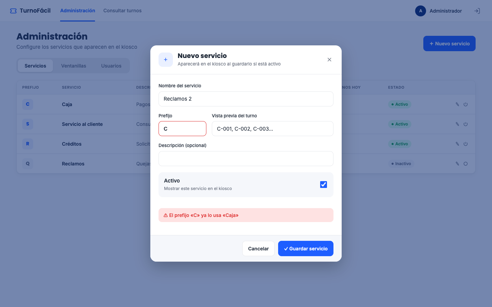

### Ventanillas

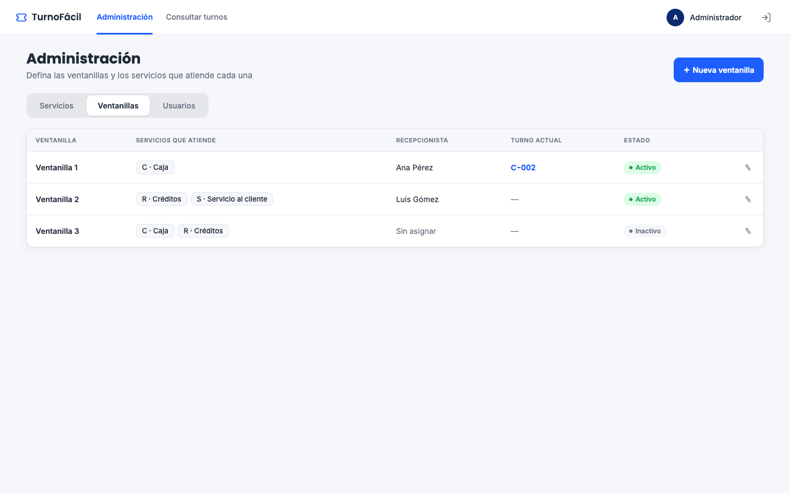

- Pulse **Nueva ventanilla**, escriba el nombre y marque los servicios que se atienden en ella. Una ventanilla puede atender varios servicios.
- La tabla muestra qué recepcionista está asignado y qué turno está atendiendo en este momento.
- Una ventanilla inactiva no puede llamar turnos.

### Usuarios

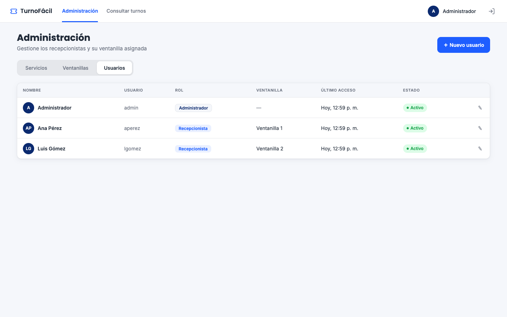

1. Pulse **Nuevo usuario**.
2. Escriba el nombre completo, el usuario de acceso y una contraseña de al menos 6 caracteres.
3. Elija el rol: **Recepcionista** (llama y cierra turnos) o **Administrador** (configura el sistema).
4. Si es recepcionista, elija su ventanilla. Pulse **Crear usuario**.

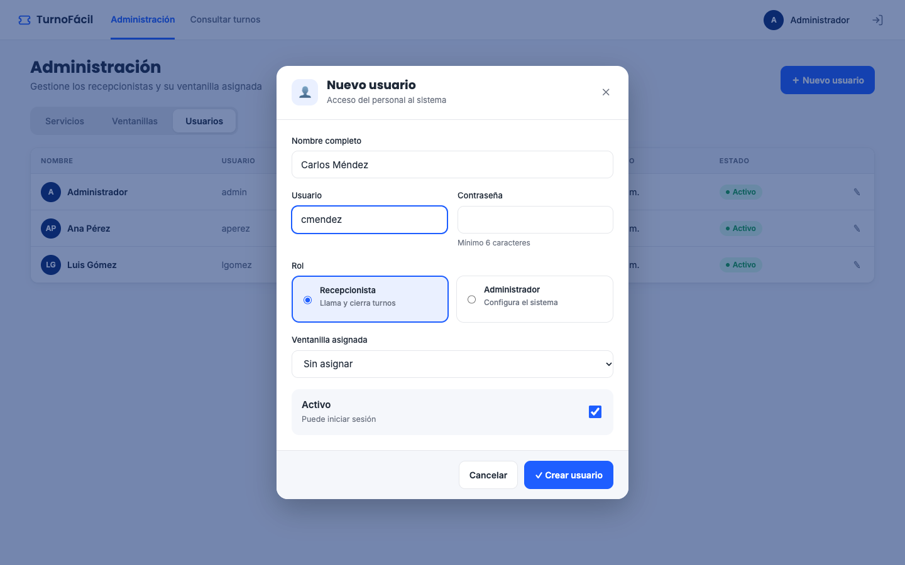

- Para cambiar una contraseña, edite el usuario y escriba la nueva; si deja el campo vacío, se conserva la actual.
- Para quitar el acceso a alguien, edítelo y desmarque **Activo**.

## 6. Consultar turnos

Disponible para administradores y recepcionistas en **Consultar turnos**.

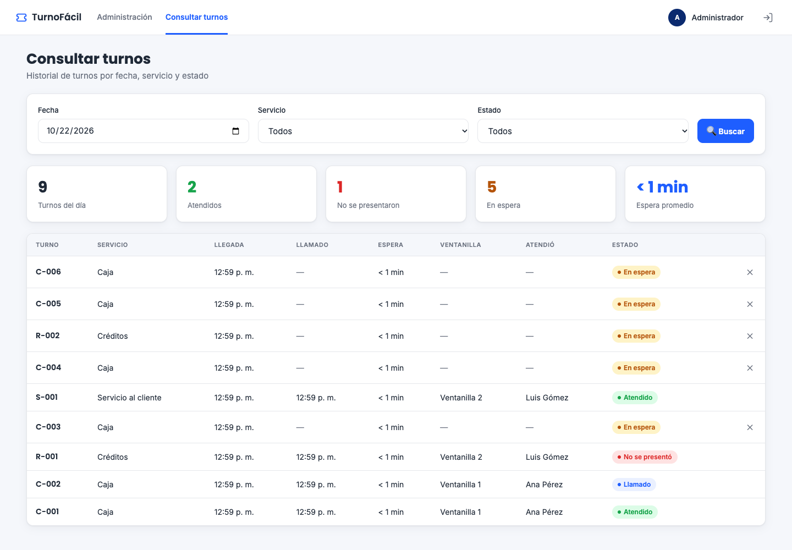

1. Elija la fecha, el servicio y el estado que quiere ver.
2. Pulse **Buscar**.
3. Arriba verá los totales del día (turnos, atendidos, no presentados, en espera y espera promedio) y abajo el detalle de cada turno.

El administrador puede **cancelar** un turno que sigue en espera con el botón ✕ de su fila; ese cliente ya no será llamado.

| Estado | Significado |
|---|---|
| 🟠 En espera | El cliente sacó el turno y espera su llamado |
| 🔵 Llamado | Se anunció en pantalla y lo están atendiendo |
| 🟢 Atendido | La atención terminó |
| 🔴 No se presentó | Se llamó y el cliente no llegó |
| ⚪ Cancelado | El administrador lo canceló antes de llamarlo |

## 7. Preguntas frecuentes

**¿Los números de turno se repiten?** Cada servicio empieza en 001 todos los días.

**Saqué el turno equivocado, ¿qué hago?** Saque otro en el servicio correcto. El administrador puede cancelar el anterior.

**La pantalla no muestra los turnos nuevos.** Revise que la TV tenga conexión; si la pierde, la pantalla avisa «Sin conexión con el servidor» y se recupera sola.

**Olvidé mi contraseña.** Pida al administrador que le asigne una nueva desde Administración → Usuarios.
